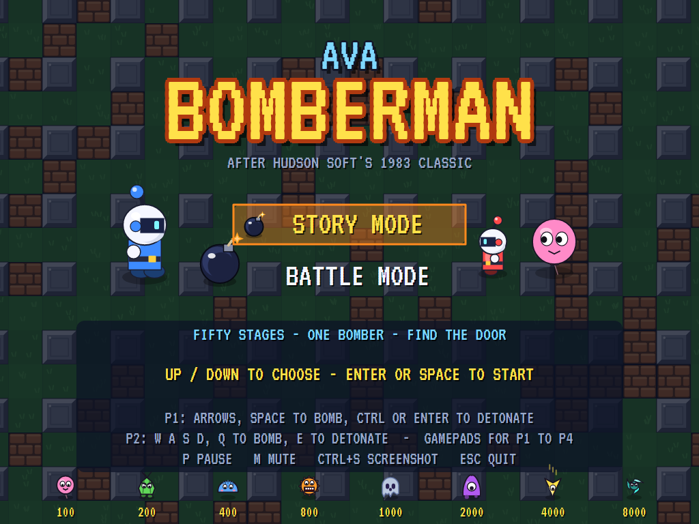
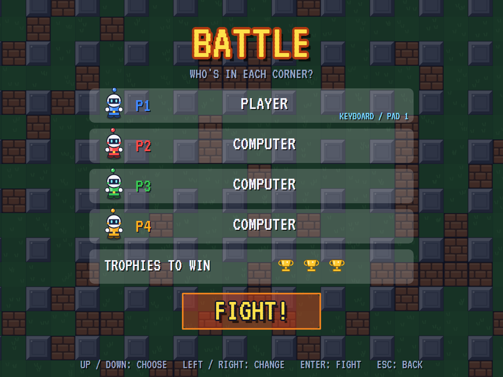
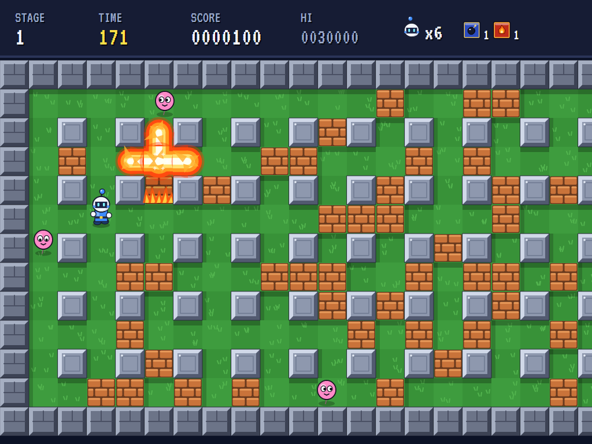
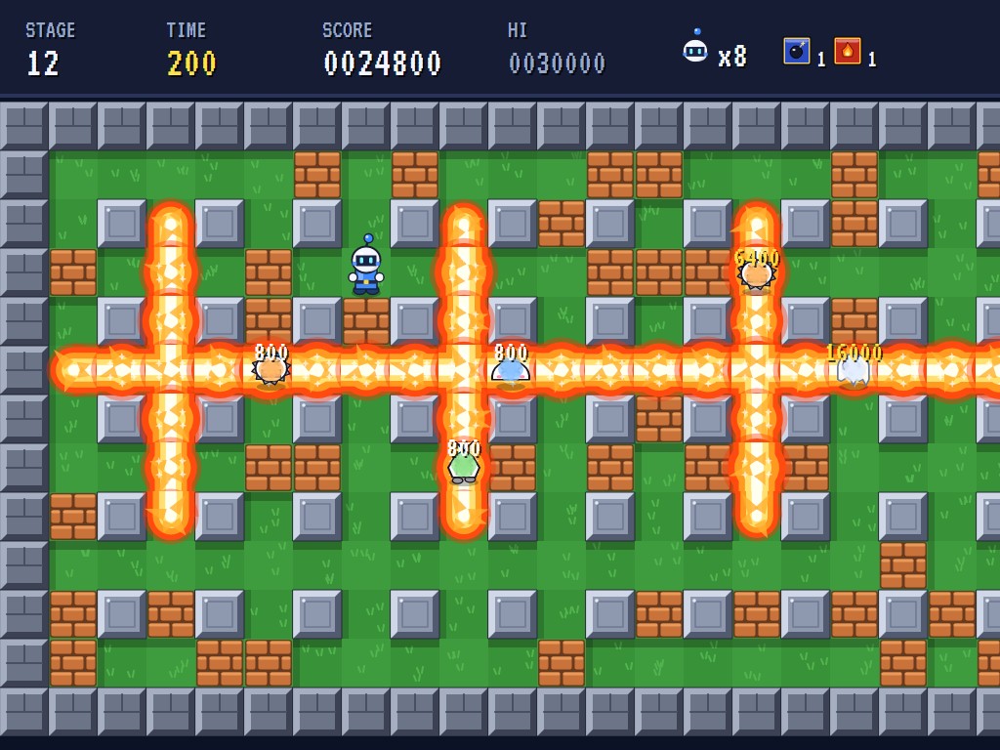
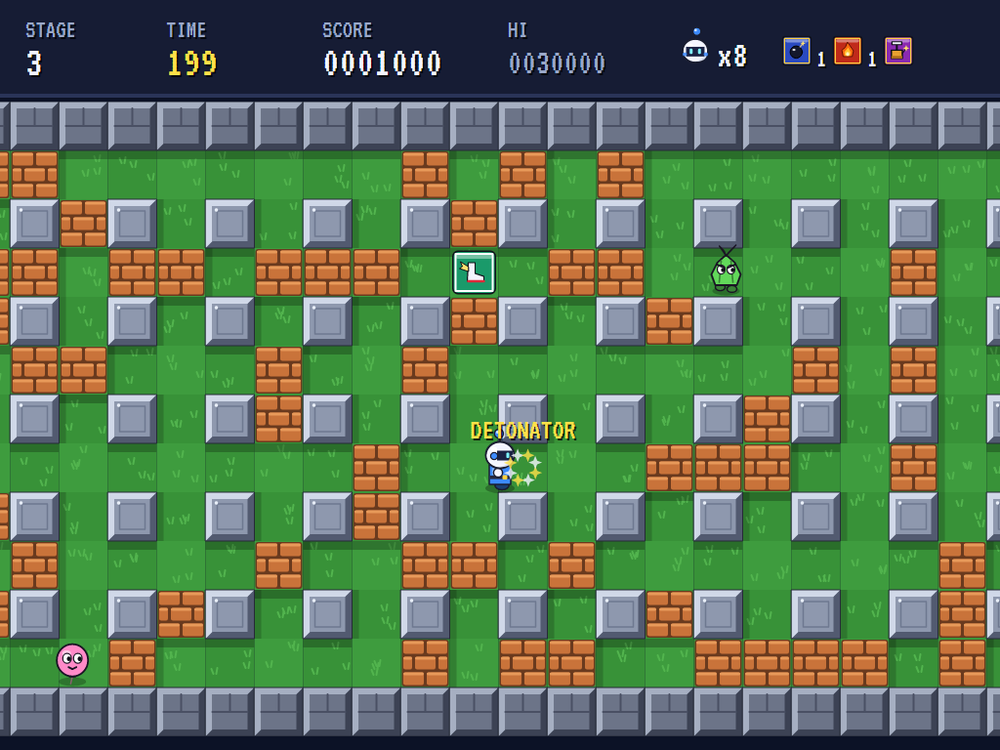
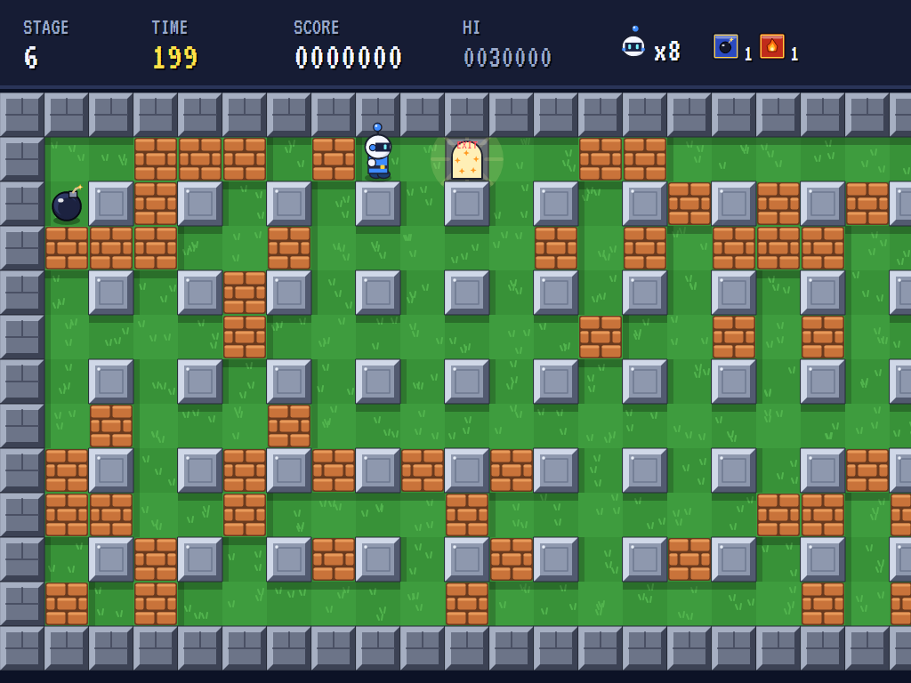
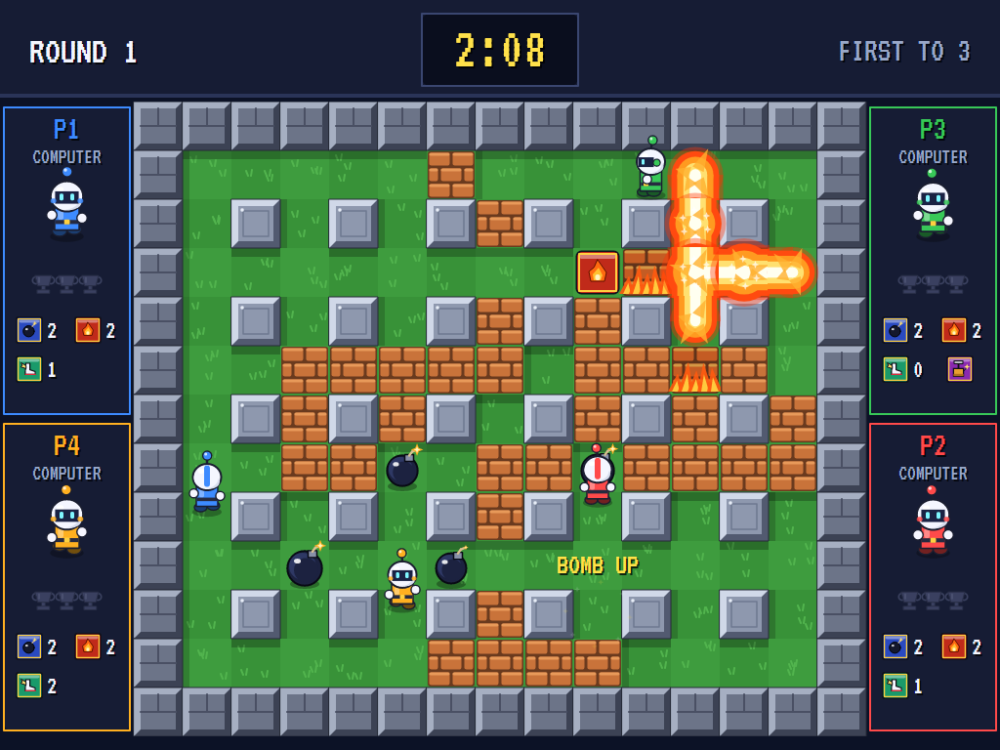
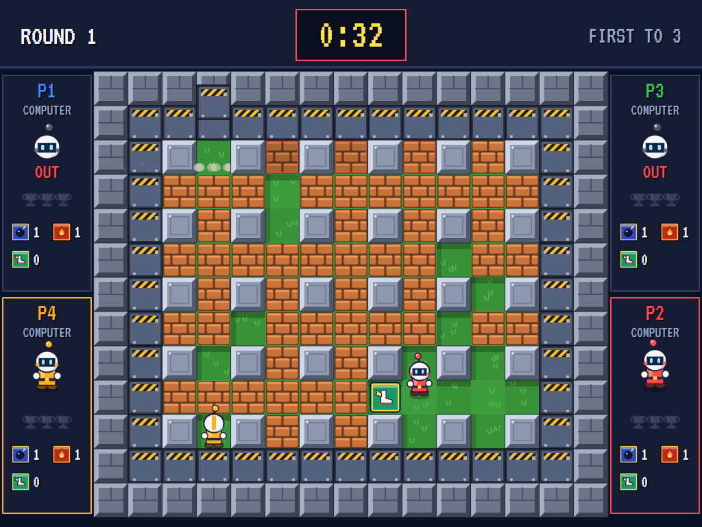
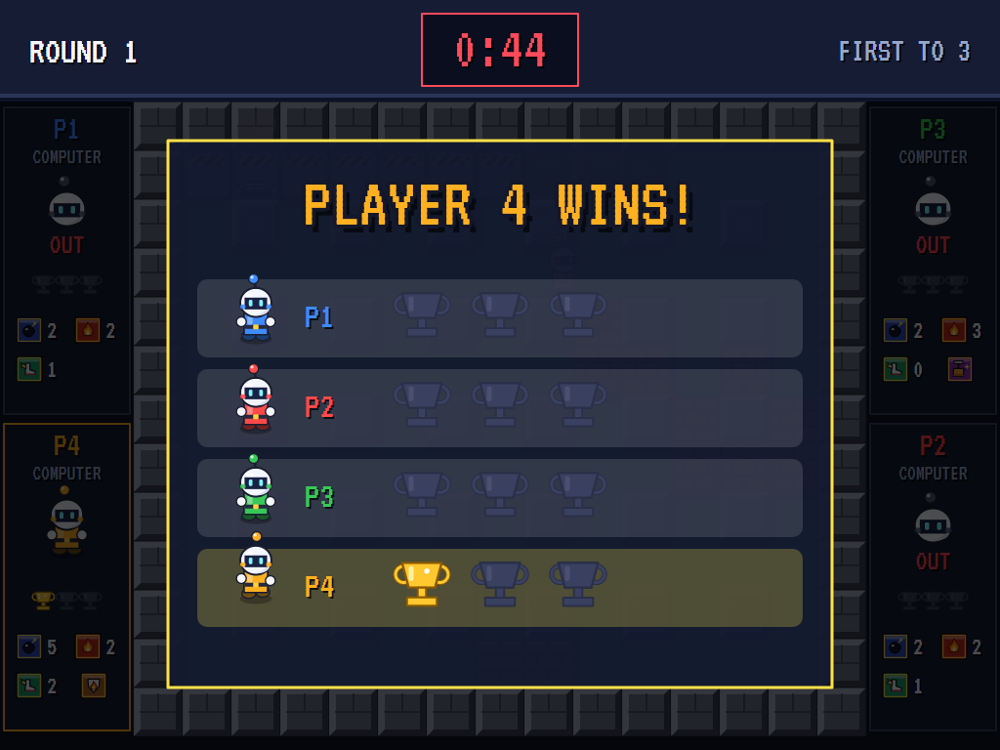
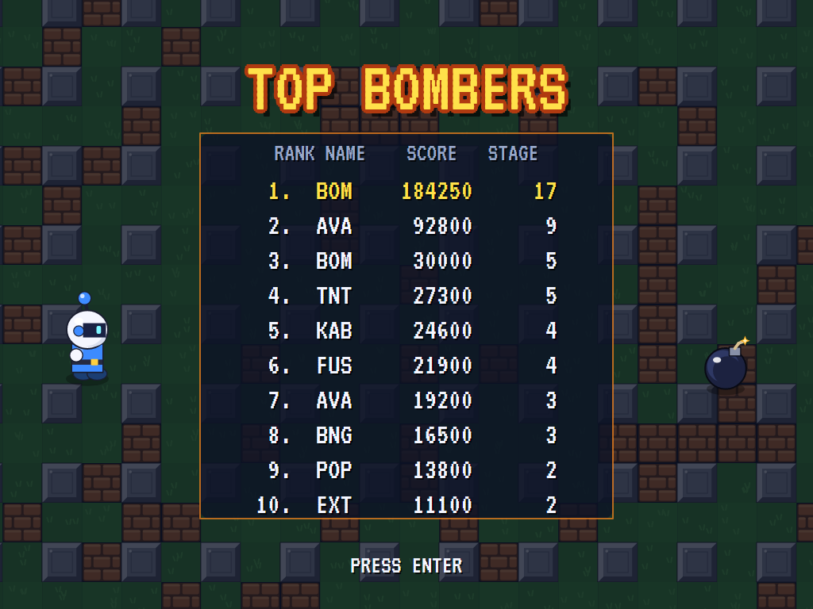

# AVA Bomberman

[](https://github.com/Harlock123/AVABomberman/actions/workflows/build.yml)

A maze-bombing game in the style of Hudson Soft's **Bomberman** (the 1983 home-computer game and the 1985 NES
version, with the later Battle mode), built with .NET 10 and Avalonia UI. In the story, a lone bomber works across
a wide field of stone pillars and brick blocks, laying bombs to blast the blocks and the creatures that roam
between them. One block hides a power-up, another the door to the next stage. In a battle, up to four bombers,
people or computer, fight it out in a one-screen arena until one is left standing.

## Features

- **The field**:
  - **Pillars and blocks:** a pillar stands wherever the row and the column are both even, with a wall all round. Brick blocks cover about a third of the open floor in the story and most of it in a battle.
  - **The story's field** is 31 cells by 13 and scrolls sideways to follow the bomber. A battle's arena, 15 by 13, fits the screen.
- **The bomber**:
  - **Walking:** along the rows and columns. Pushed into a pillar's corner while partly past it, it slides round it, as the original does, so it needn't be lined up exactly to turn. Holding a diagonal walks a staircase through the pillars.
  - **Bombs:** one at a time at first. A bomb bursts after two and a half seconds in a cross of flame, one cell each way at first. It can be walked off but not back on to.
- **Flames**:
  - They stop at pillars and at the first block, which burns away to show what was under it.
  - A bomb caught in a blast goes off with it, so chain reactions run along a row of bombs.
  - They catch the bomber, the creatures and any power-up lying in the open.
- **Power-ups**, one hidden on each story stage and plenty in a battle's blocks:
  - **Bomb up**, **fire up** (a cell further) and **speed up** (roller boots)
  - **Detonator:** the bombs wait for the detonator button, oldest first
  - **Wall pass** (walk through blocks, but don't be inside one that burns), **bomb pass** (walk over bombs), **flame-proof**
  - **Mystery:** twelve seconds when nothing can hurt the bomber
- **The story**:
  - **Fifty stages**, harder and harder: six creatures at first, ten by the end, each new kind arriving a few at a time.
  - **The door:** blow up every creature, find the door under its block, and walk in. Blasting the door, or a power-up, lets out a crowd of tougher creatures.
  - **The clock:** two hundred seconds a stage. When it runs out, eight whirlwinds flood in.
  - **Bonus stages:** after every fifth stage, thirty seconds on an open field where nothing can hurt the bomber, with a crowd of creatures to catch.
  - **Lives:** three. Losing one plays the stage again and loses the special powers (the bombs, fire and speed are kept).
- **The creatures** (all new designs):
  - **Puffle** (100), a pink balloon that drifts about; **Sprout** (200), a green bulb that turns more often; **Dumpling** (400), a blue dumpling bouncing along
  - **Grinner** (800), a fast, grinning disc that comes after you; **Wisp** (1,000), a slow, clever ghost that drifts through blocks
  - **Gloop** (2,000), a purple slime that oozes through blocks; **Dart** (4,000), a fast, clever arrowhead; **Whirl** (8,000), the fastest of all, through blocks and after you
  - The keen ones head for the bomber when it's near; the others wander.
- **Scoring:** each creature caught by the same blast (chain reactions and all) is worth double the last. A power-up is worth 1,000.
- **The battle**:
  - **Up to four bombers,** each corner a person, the computer or nobody. Two people share the keyboard; gamepads for up to four.
  - **Rounds:** last one standing takes the round and a trophy (a moment's grace first, in case the last blast takes the survivor too). Choose one to five trophies to win.
  - **Hurry up!** With forty-five seconds left, steel blocks start dropping round the arena from the top left corner, spiralling in and crushing whoever is under them, until only the middle is left.
  - **The computer bombers** work out when the fire will reach every cell, chains and all, and search through time as well as space for a way out of danger, waiting for a blast to die down where that's quickest. They break blocks, pick up power-ups, chase opponents, lay bombs where they'll catch them (or cut off their way out), and use the detonator once they're clear.
- **Sound**:
  - **The music:** the galloping finale of Rossini's *William Tell Overture* (1829, public domain): brisk on a chip voice through the stages, at an easier canter on a music-box voice for the title. New jingles for the stage start, stage clear, the battle's winner and the game's end.
  - **The effects:** footsteps, the bomb going down and its fizzing fuse, the blast, blocks crumbling, power-ups, creatures popping, the bomber's fall, the door opening, creatures let out, the hurry-up alarm and its blocks thumping down.
  - All of it is synthesised and mixed by OpenAL.
- **Attract mode**: leave the title alone for 15 seconds and the computer plays: the story, then the next time a four-way battle between computer bombers.
- **A top-ten high-score table** for the story, with arcade-style initials entry. It records the stage reached.
- **Gamepads** through SDL2, as well as the keyboard.
- **Any window size**: the screen scales to fit, letterboxed. **Ctrl+S** saves a screenshot.
- **One self-contained executable** per platform: Windows, macOS and Linux on Intel/AMD and ARM.

## Screenshots

| The title | A battle's setup | A blast |
|:---------:|:----------------:|:-------:|
|  |  |  |
| Story or battle. | Who's in each corner. | A block burning away on stage 1. |

| A chain reaction | A power-up | The door |
|:----------------:|:----------:|:--------:|
|  |  |  |
| Six bombs, one blast: each creature caught worth double the last. | The detonator, and roller boots lying by. | Every creature gone: the door is open. |

| Four-way battle | Hurry up! | The winner |
|:---------------:|:---------:|:----------:|
|  |  |  |
| Four computer bombers at it. | The blocks spiralling in. | A trophy for the last one standing. |

| Top bombers | | |
|:-----------:|:-:|:-:|
|  | | |
| The high-score table. | | |

The screenshots are made by the tests, which play the game in a real (headless) window; see
[Tests](#tests).

## Download and run

Ready-to-run builds for Windows, macOS and Linux, on both Intel/AMD and ARM, are on the
[Releases page](https://github.com/Harlock123/AVABomberman/releases/tag/latest). **Latest build** is rebuilt
on every push to `main`. Each download is one self-contained executable: no .NET install is needed.

| Platform | Archive |
|---|---|
| Windows | `AVABomberman-win-x64.zip`, `AVABomberman-win-x86.zip`, `AVABomberman-win-arm64.zip` |
| macOS | `AVABomberman-osx-arm64.tar.gz` (Apple silicon), `AVABomberman-osx-x64.tar.gz` (Intel) |
| Linux | `AVABomberman-linux-x64.tar.gz`, `AVABomberman-linux-arm64.tar.gz`, `AVABomberman-linux-arm.tar.gz` |

```bash
tar -xzf AVABomberman-linux-x64.tar.gz     # or linux-arm64, linux-arm, osx-arm64, osx-x64
./AVABomberman
```

On Windows, unzip and run `AVABomberman.exe`. On macOS, if Gatekeeper refuses to open it, run
`xattr -d com.apple.quarantine AVABomberman` once. Run with `--no-audio` for silence.

**Sound** comes through OpenAL Soft, built in for every platform. In a virtual machine the game
detects it and uses a larger audio buffer, so the sound doesn't break up.

**Gamepads** use SDL2, which is bundled for Windows, macOS and Intel/AMD Linux. ARM Linux builds need it
installed; without it the keyboard still works:

```bash
sudo apt install libsdl2-dev            # Debian / Ubuntu / Raspberry Pi OS
sudo pacman -S --needed sdl2-compat     # Arch / Omarchy
```

## Controls

| Input | Player 1 | Player 2 |
|-------|----------|----------|
| Walk | **Arrow keys** (or the numeric keypad) | **W A S D** |
| Lay a bomb | **Space** | **Q** |
| Detonate (with the detonator) | **Ctrl** or **Enter** | **E** |
| Gamepad | pad 1 | pad 2 |

Playing on your own (the story, or a battle with one person), every key set works for you. Players 3 and 4
play on gamepads 3 and 4. On a gamepad: the left stick or D-pad walks, **A** lays a bomb, **B** or **X**
detonates, **Start** pauses, and **Back** (while paused) goes back to the title.

| Input | Action |
|-------|--------|
| **Up** / **Down**, **Enter** or **Space** | Choose on the title and the battle setup; **Left** / **Right** change a corner or the trophies |
| **P** / **Esc** | Pause (Esc again for the title; on the title, Esc quits) |
| **M** | Mute |
| **Ctrl+S** / **Cmd+S** | Save a screenshot to the Pictures folder |

**Entering initials**: type letters, or dial with **Up**/**Down** and accept with **Space**; **Left** /
**Backspace** go back; **Enter** finishes.

## Tests

```bash
dotnet test AVABomberman.slnx
```

The engine has no UI and runs in fixed 60 Hz steps, so it plays the same at any frame rate, and a seed
always plays the same game. The tests check:

- **The fields:** the story's pillars, blocks, hidden door and power-up and clear start, every cell reachable, the same layout each time a stage is played; the stages getting harder and each hiding its own power-up; the battle arena's clear corners and hidden power-ups; the hurry-up's spiral
- **Walking:** along the rows, stopped by pillars, sliding round a pillar's corner, a held diagonal turning at the next opening
- **The keys:** Up and Down through the input handler moving the bomber up and down the screen, the keyboard split between two players (and each person's keys reaching their own bomber in a battle), and a key let go under another name (a Shift released as CapsLock) still let go
- **Bombs and flames:**
  - walking off a bomb but not back on, one bomb at a time and more with the power-up
  - the fuse, the cross of flame, fire's reach, and pillars stopping it
  - flames stopping at the first block, which burns away to show what's under it
  - chain reactions, as one blast
  - the bomber caught (unless flame-proof or invincible), and caught inside a burning block with wall pass
- **Scoring:** creatures caught by one blast doubling up, chain reactions included
- **Power-ups:** every kind picked up, the detonator setting off the oldest bomb first, bomb pass and wall pass, and a power-up burnt by the flames letting creatures out
- **The door:** opening once the creatures are gone and taking the bomber to the next stage, and a blasted door letting out a crowd (once a blast)
- **The clock:** the whirlwinds flooding in when it runs out
- **The creatures:** keeping to the open, or drifting through blocks; a keen one coming after the bomber; catching it by touch; turning back from a bomb
- **The story:** losing a life (the stage again, without the special powers), the bonus stage after every fifth, game over and the high-score file, the computer clearing the first stage
- **The battle:** setting it up through the menu with the keys, needing two bombers, the last one standing winning trophies and the battle, draws (and a winner caught in the moment after), power-ups out of the blocks, the hurry-up's blocks crushing and filling the arena but the middle
- **The computer bombers:** getting out of the way of a bomb, clearing blocks and taking power-ups on their own without blowing themselves up, fighting a round to a finish, running from the hurry-up, and using the detonator once clear
- **The machine:** the attract cycle (story, then a computer battle), pause, and the same game from the same seed

The screenshot tests draw the real screen in a headless window. To refresh the README's pictures:

```bash
BOMBER_SHOTS=$PWD/Images dotnet test tests/AVABomberman.Tests --filter ScreenshotTests
```

To see how the computer gets on, stage by stage through the story (`BOMBER_PROBE=story`) or in four-way
battles (`BOMBER_PROBE=battle`), for tuning:

```bash
BOMBER_PROBE=battle dotnet test tests/AVABomberman.Tests --filter PilotProbe --logger "console;verbosity=detailed"
```

## Building

```bash
dotnet build AVABomberman.slnx
dotnet run --project src/AVABomberman
```

Needs the .NET 10 SDK. The sounds are made by `tools/make_sounds.py` (standard-library Python):
`python3 tools/make_sounds.py` rewrites `src/AVABomberman/Sounds`.

## Project structure

```
AVABomberman/
├── AVABomberman.slnx
├── src/AVABomberman/
│   ├── Engine/
│   │   ├── GameEngine.cs          # States, the title menu and battle setup, the demo cycle, and the music
│   │   ├── GameEngine.Play.cs     # Walking and the corner slide, bombs, flames and chains, burning blocks,
│   │   │                          # power-ups, who's been hit, and scoring
│   │   ├── GameEngine.Story.cs    # The fifty stages, the creatures and how they move, the door, the clock,
│   │   │                          # bonus stages and lives
│   │   ├── GameEngine.Battle.cs   # Rounds, trophies and the hurry-up's closing walls
│   │   ├── Board.cs               # The story's fields and the battle's arenas; distances; the hurry-up spiral
│   │   ├── BomberPilot.cs         # The computer bombers (and the story's demonstration)
│   │   ├── Entities.cs
│   │   ├── HighScoreTable.cs, InitialsEntry.cs
│   │   ├── InputHandler.cs, ControllerManager.cs  # Keys split between two players, and up to four SDL2 gamepads
│   │   └── SoundManager.cs        # Effects and the tunes through OpenAL
│   ├── Audio/                     # The OpenAL engine (from the author's AVABand)
│   ├── Views/                     # The field and its camera, the bar and panels, the menus and screens,
│   │                              # and the bombers, creatures, bombs and flames drawn from shapes
│   └── Sounds/                    # The synthesised effects and tunes
├── tests/AVABomberman.Tests/      # Gameplay, screenshot and probe tests
├── tools/make_sounds.py
└── Images/                        # Screenshots
```

## About and licence

AVA Bomberman © 2026 Lonnie Watson, under the [MIT License](LICENSE).

*Bomberman* © Hudson Soft / Konami; the name belongs to its owner. AVA Bomberman is an independent, unofficial
game in its style. Its bombers, creatures, graphics, sounds, jingles and code are its own; nothing is taken
from any Bomberman game's program, graphics, sound or music. It is not affiliated with or endorsed by any
rights holder. The music is an arrangement of the finale of Gioachino Rossini's *William Tell Overture* (1829),
which is in the public domain.
